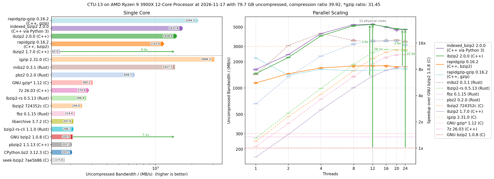
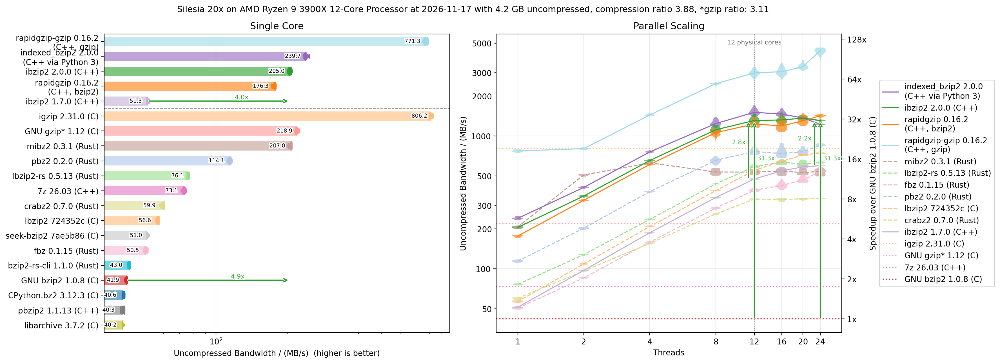
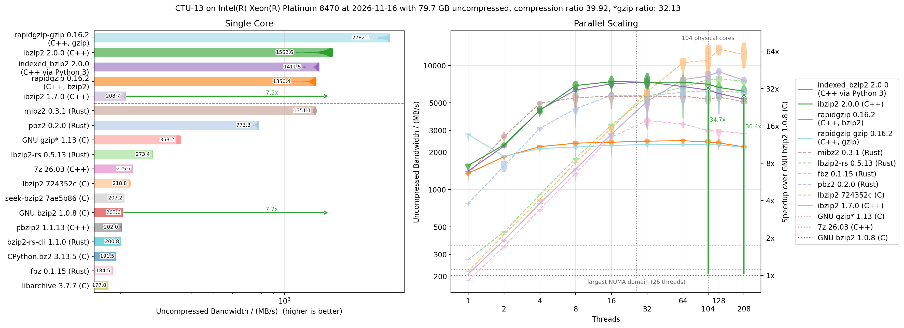
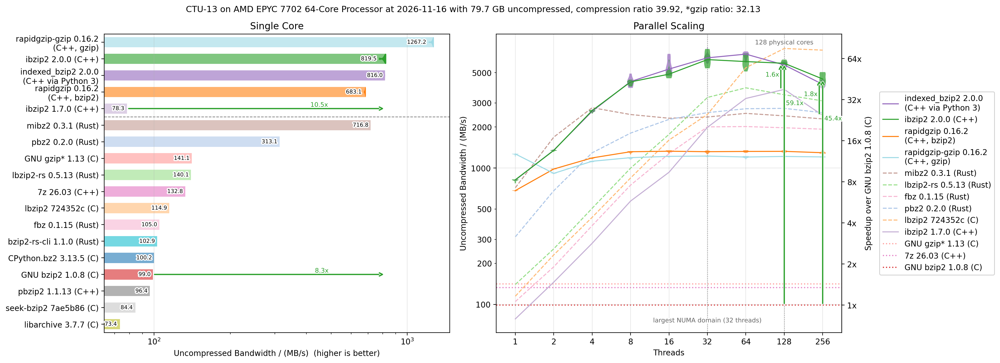
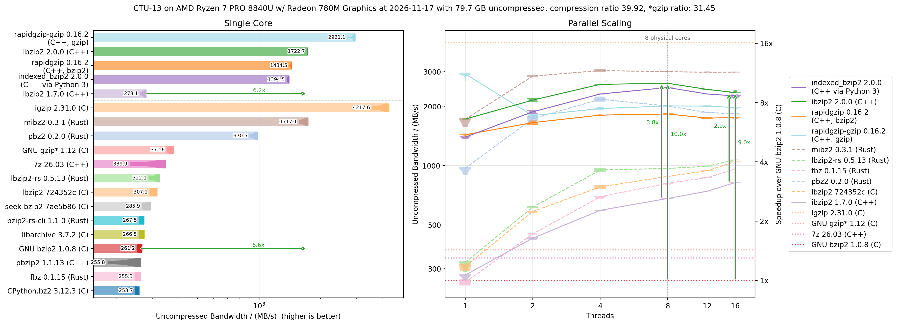
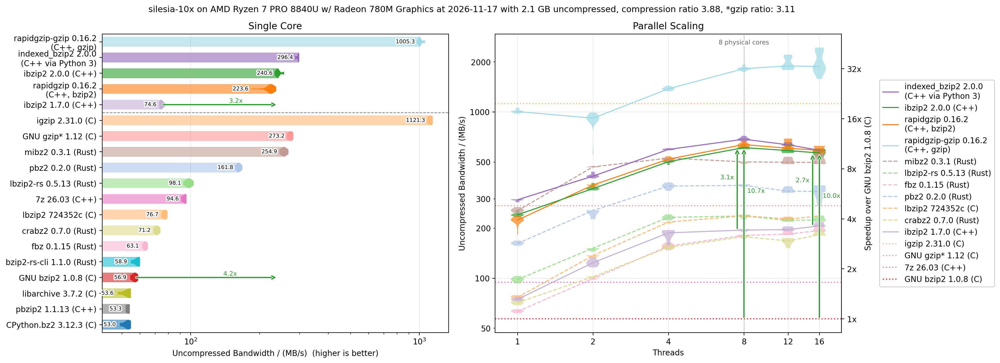
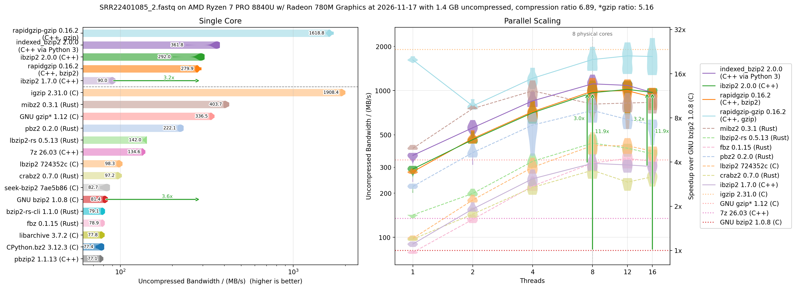

# indexed_bzip2 2.0.0 benchmarks

This folder contains the benchmark tooling, the per-machine JSON results, and the plots for the
`indexed_bzip2` 2.0.0 release. The release compares the Python module `indexed_bzip2` and the `ibzip2`
command-line tool with 1.7.0 and with the usual reference decoders.

## Systems

The committed runs use four x86-64 machines:

- **Ryzen 9 3900X**: 12 physical cores, 24 hardware threads, 96 GiB RAM.
  A stable desktop reference for multi-thread scaling.
- **Ryzen 7 PRO 8840U**: 8 physical cores, 16 hardware threads, 32 GiB RAM.
  A Zen 4 notebook with AVX-512. Its benchmarks are noisy because of power, thermal, and frequency throttling.
- **Barnard (Xeon Platinum 8470)**: 104 physical cores, 208 hardware threads, AVX-512, 512 GiB RAM. Full-node CTU-13 runs.
- **Romeo (EPYC 7702)**: 128 physical cores, 256 hardware threads, AVX2, 512 GiB RAM. Full-node CTU-13 runs.
  Romeo and Barnard experienced random, frequent launch delays because the global shared filesystem, on which the shared libraries are stored, has few-second-long I/O stalls. The sbatch script tries to minimize this by copying all binaries and shared libraries into `/dev/shm`, but some of them, or other I/O accesses, might have been missed.

## Datasets

- **Silesia** (`silesia.tar.bz2`): 211,957,760 B uncompressed, compression ratio 3.88. The official
  [silesia.zip](https://sun.aei.polsl.pl/~sdeor/corpus/silesia.zip) has MD5 `c240c17d6805fb8a0bde763f1b94cd99`.
  The raw tar is also mirrored at [silesia.tar](https://mirror.circlestorm.org/silesia.tar).
  This decompresses in hundreds of milliseconds.
  It was only used for quick tooling checks and is not part of the committed gallery.
- **Silesia-10x** and **Silesia-20x**: the same raw tar concatenated 10 or 20 times and compressed as one bzip2 stream.
  They have the same ratio but provide 2.1 GB and 4.2 GB of output, so startup and frequency overhead are relatively smaller.
- **CTU-13** (`CTU-13-Dataset.tar.bz2`): 79,747,543,040 B uncompressed, compression ratio 39.92.
  Download the [CTU-13 dataset](https://mcfp.felk.cvut.cz/publicDatasets/CTU-13-Dataset/CTU-13-Dataset.tar.bz2).
  The high ratio makes CRC and the RLE/literal paths a large part of the work.
- **SRR22401085_2.fastq**: 1,362,885,348 B uncompressed, compression ratio 6.89.
  Real FASTQ data from [NCBI SRA SRR22401085](https://www.ncbi.nlm.nih.gov/sra/?term=SRR22401085) with a medium ratio.

## Decompressors

The comparison uses these projects. The exact versions and build recipes are in [`build-other-tools.sh`](build-other-tools.sh) and the JSON metadata.

These are all part of this repository:

 - [`indexed_bzip2`](https://github.com/mxmlnkn/librapidarchive/tree/master/python/indexed_bzip2): This is the [Python-wrapper](https://github.com/mxmlnkn/librapidarchive/blob/HEAD/python/indexed_bzip2/indexed_bzip2.pyx) for the librapidarchive class [`ParallelBZ2Reader`](https://github.com/mxmlnkn/librapidarchive/blob/HEAD/src/indexed_bzip2/ParallelBZ2Reader.hpp), and [`BZ2Reader`](https://github.com/mxmlnkn/librapidarchive/blob/HEAD/src/indexed_bzip2/BZ2Reader.hpp) for no parallelization.
   The parallelization is realized with one or more producer block finder threads that search for bzip2 magic bits and as many decompression threads as requested that decompress each bzip2 block in parallel. I have never encountered false positives for bzip2 magic bytes, which makes this parallelization scheme much easier.
 - `ibzip2`: This is the contracted name I used for the [command line tool](https://github.com/mxmlnkn/librapidarchive/blob/HEAD/src/tools/ibzip2.cpp), which uses `ParallelBZ2Reader`, and `BZ2Reader` for no parallelization.
 - [`rapidgzip`](https://github.com/mxmlnkn/rapidgzip): This is the name of the [command line tool](https://github.com/mxmlnkn/librapidarchive/blob/HEAD/src/tools/rapidgzip.cpp) and also the [Python wrapper](https://github.com/mxmlnkn/librapidarchive/blob/master/python/rapidgzip/rapidgzip.pyx) for [`ParallelGzipReader`](https://github.com/mxmlnkn/librapidarchive/blob/master/src/rapidgzip/ParallelGzipReader.hpp).
   It **also** supports bzip2 decompression in addition to gzip/zlib/deflate, but it uses a different speculative parallelization scheme that was necessary for gzip.
   This has the downside that it works on compressed chunks of several MB in size, which will contain more than one bzip2 block.
   It requires no different block offset finder threads, but it has more memory overhead and, to avoid huge memory overhead, it currently limits parallel decompression for very high compression ratios and falls back to serial decompression for those high-ratio chunks.
 - [`indexed_bzip2` 1.7.0](https://pypi.org/project/indexed-bzip2/1.7.0): The last version [released to PyPI](https://pypi.org/project/indexed-bzip2/1.7.0/).

Well-known established tools, many available in the Debian/Ubuntu repository:

 - [GNU bzip2](https://sourceware.org/bzip2), [pbzip2](https://compression.great-site.net/pbzip2), [lbzip2](https://github.com/kjn/lbzip2), [seek-bzip2](https://github.com/galaxyproject/seek-bzip2), [7-Zip](https://www.7-zip.org), [CPython `bz2`](https://docs.python.org/3/library/bz2.html), [GNU gzip](https://www.gnu.org/software/gzip), [pigz](https://zlib.net/pigz), [ISA-L igzip](https://github.com/intel/isa-l), [zlib](https://zlib.net), [libarchive](https://www.libarchive.org/)

Tools found via crates.io, most of them [very new](https://github.com/mxmlnkn/librapidarchive/blob/HEAD/results/ai/rust-decompressor-crates-vetting.md#health-and-activity):

 - [lbzip2-rs](https://github.com/Ignalina/lbzip2-rs), [pbz2](https://github.com/soof-golan/pbz2), [fbz](https://github.com/AnswerDotAI/fbz), [mibz2](https://github.com/lmmx/mibz2), [crabz2](https://github.com/jwmurray/crabz2), [libbzip2-rs](https://github.com/trifectatechfoundation/libbzip2-rs)

## How to read the plots

Each plot has two panels. The left panel shows single-core bandwidth with zero-based bars and violin overlays to show the variance over many repeats. Sectioned off at the top are the four tools from this repository, including one older version: ibzip2 1.7.0.

The right panel shows thread scaling. The violins omit runs beyond ten median absolute deviations from the median. Those are usually process-launch stalls on a small input, where a 0.1 s run preceded by a 10s stall results in a 100x outlier.
Solid lines are tools from this repository. Other tools are drawn with dashed lines.

The most interesting lines for bzip2 decompression of this repository via various wrappers and threading architectures are in saturated green, purple, and orange. The half-transparent or dashed lines are for comparison. For Silesia and `SRR22401085_2.fastq`, the fastest values are for ISA-L(igzip)-accelerated `rapidgzip-gzip`, which decompress gzip versions of the dataset, not bzip2, and are only there to compare bzip2 vs. gzip decompression.

## Results

The gallery starts with the stable desktop runs, followed by the large-scale HPC runs, and ends with the very noisy notebook runs.

### Ryzen 9 3900X

#### CTU-13

#### Silesia-20x

### Xeon Platinum 8470 with CTU-13

### EPYC 7702 with CTU-13

### Ryzen 7 PRO 8840U

#### CTU-13

#### Silesia-10x

#### SRR22401085_2.fastq

### Evaluation and notes

 - ibzip2 is one of the fastest in all single-core benchmarks. Several times faster than bzip2,
   even faster than GNU gzip, especially on high-ratio files because those are dominated by CRC32
   and other SIMD-accelerated algorithms. Other much more optimized gzip decompressors, such as
   [igzip](https://github.com/intel/isa-l), [zlib-ng](https://github.com/zlib-ng/zlib-ng),
   [libdeflate](https://github.com/ebiggers/libdeflate), ... exist and are 2-4x faster than ibzip2.
 - The optimized ibzip2 does not scale very well above the physical core count, presumably because
   the interleaved inverse-BWT chain walk already explicitly hides all memory load latencies, which
   the virtual cores would have hidden efficiently. At this point, the decompression might be
   bottlenecked by the memory bandwidth and low (L3) cache reuse for that chain walk in the 900 KB
   block. This walk is basically random pointer chasing and causes a full cache line load, only for
   most often only a single byte being used, ergo 64x more physical bandwidth than the algorithm
   accesses bytes on most systems.
 - lbzip2 scales better for high thread counts, even surpassing ibzip2 2.0.0 and mibz2 on
   [Xeon Platinum 8470](#xeon-platinum-8470-with-ctu-13). This might be because the version,
   which is slower on single-core, has better higher-level cache behavior when scaled up.
   Fine-tuning the interleaved chain-walk lane count based on the parallelization might improve
   scaling over all thread counts.
 - mibz2 seems to be especially optimized for FASTQ files, for which it outperforms ibzip2.
   mibz2 [`is worked on by an agent team`](https://github.com/lmmx/mibz2#working-with-the-agent-team)
   and has come into existence only days before this benchmark and has had dozens of version releases
   since then. The benchmarked version is out of date as soon as the benchmarks, which can take hours,
   have finished. So, it might already be faster by now.
 - Bzip2 decompression with rapidgzip for CTU-13 does not scale with parallelization because the limits
   of `ParallelGzipReader`, which can also decode bzip2, limits itself for very high compression ratios
   like those encountered in CTU-13 to reduce memory exhaustion and simply stops decompression on
   parallel workers after some cut-off.
 - The release notes' **2-8x** figure is the combined 2.0.0 improvement over 1.7.0 across these
   datasets and thread counts. The **>30x** figure is relative to Python's built-in `bz2` module at
   24 threads on Silesia-20x and CTU-13.

## Largest successful optimizations

- **Lane-walking inverse BWT and SIMD symbol kernels (2.0.0, x86-64).** The decoder no longer calls
  libsais. The last-to-first mapping is marked at regular intervals and walked by 8 or 24 interleaved
  lanes with software prefetch and an SSE2/AVX2/AVX-512 mapping builder. The symbol pass emits run
  records, and the SSE4.1/AVX2 kernels keep the first 32 Move-to-Front entries in registers and merge
  runs without branches. See
  [Bzip2InverseBWT.hpp](../../../src/indexed_bzip2/Bzip2InverseBWT.hpp),
  [Bzip2SymbolDecoder.hpp](../../../src/indexed_bzip2/Bzip2SymbolDecoder.hpp),
  and [OPTIMIZATIONS.md](../../ai/bzip2/OPTIMIZATIONS.md). The older reports describe the libsais
  stage. The in-tree chain walk replaced it for 2.0.0, so read the libsais percentages as history.
- **SIMD MTF and RLE expansion (2.0.0, x86 and NEON).** A packed 64-bit MTF list with a branchless
  SSE2 update, a 16-byte RLE scan, and an AVX-512 scan on capable x86. NEON MTF/RLE is in 2.0.0, but it
  is not exercised by the x86 gallery. See [OPTIMIZATIONS.md](../../ai/bzip2/OPTIMIZATIONS.md) and
  [arm-report.md](../../ai/arm/arm-report.md).
- **PCLMUL/VPCLMUL CRC for high-ratio data (2.0.0, x86-64).** Non-reflected PCLMUL and VPCLMUL folding
  with runtime dispatch. It is nearly neutral on balanced text, but it is decisive on run-heavy
  extremes: zeros 4.17x, rle1-boundaries 2.95x, and highratio 1.89x at one thread in
  [extreme-case-results.md](../../ai/bzip2/extreme-case-results.md). ARM has no PMULL path here; the
  [arm-report.md](../../ai/arm/arm-report.md) estimates at most 4-5% from adding one.
- **Packed Huffman/MTF and branchless scalar work (2.0.0).** Smaller packed lookup and MTF
  representations, a 64-bit MSB-first bit-buffer refill, one-symbol lookahead, short-run slack stores,
  exact-size block buffers, and last-block prefetch. The scalar phase is what made the single-core
  speedup possible before the lane walk. See [OPTIMIZATIONS.md](../../ai/bzip2/OPTIMIZATIONS.md) and
  [extreme-case-results.md](../../ai/bzip2/extreme-case-results.md).
- **Parallel decode and buffer reuse (2.0.0).** The block-level worker pool, heap-allocated per-block
  state, worker-side next-header parse, and reused per-block scratch turn the single-core gains into
  the 8- to 12-thread peaks. The parallel path is hardware-bound rather than kernel-bound on these
  machines. See the parallel and buffer sections in [OPTIMIZATIONS.md](../../ai/bzip2/OPTIMIZATIONS.md)
  and the release overview in [ai-work-overview.md](../../ai/release/ai-work-overview.md).
